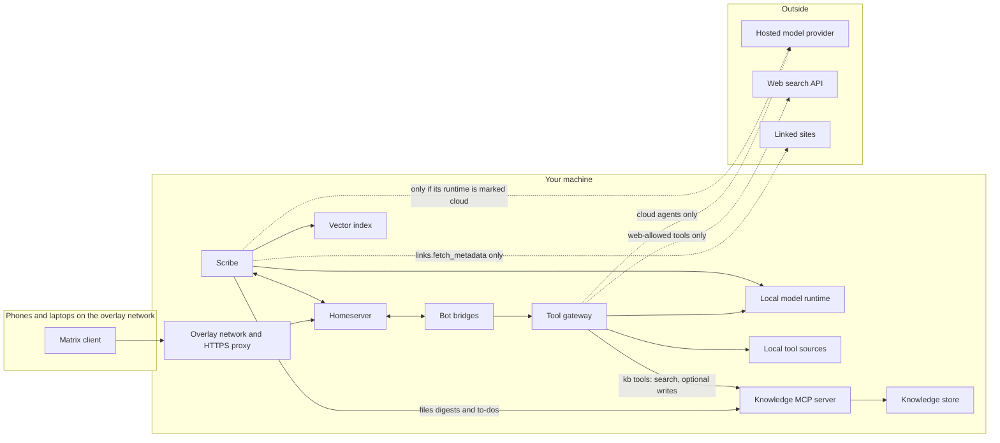

# Architecture

This page lists the parts of the workspace, how a message moves through them, where the trust boundaries sit, and why the main choices were made. Each part is described by its role. The reference implementation column names what the reference deployment uses; any tool that meets the role works.

## Terms

| Term | Meaning |
|---|---|
| Server name | The part after `:` in a Matrix user ID, such as `example.com`. It is fixed when the homeserver first starts and cannot change later. |
| Delegated host | The host clients actually connect to, such as `mesh-host.example.net`. The server name points to it through two `.well-known` files. |
| Static host | Any web host that serves the two `.well-known` JSON files for the server name. It sees nothing else. |
| MXID | A Matrix user ID, such as `@alice:example.com`. |
| Device | One logged-in session of a Matrix account, with its own encryption keys. Every client app and every bot has its own. |
| Persona | An agent as the room sees it: a Matrix user such as `@local-agent`, with a name, a model and a set of permitted tools. |
| Overlay network | A private network that your devices join, so services need no public ports. |
| Data residency | Where data is allowed to go. A "local" tool touches data on your machine; a "cloud" agent runs on a hosted model. |
| Tool source | Anything that provides tools to an agent, such as a search API or a knowledge store. |
| Upstream | The model endpoint an agent's requests are finally sent to, either the local runtime or a hosted provider. |

## Roles

| Role | What it does | Reference implementation | Compose service | Chapter |
|---|---|---|---|---|
| Private overlay network | Gives the host a stable internal name, TLS and access control between devices | Tailscale | None | 01 |
| Homeserver | Stores rooms and messages, handles accounts and delivery | Synapse | `homeserver` | 02 |
| Homeserver database | Stores the homeserver's data | Postgres | `homeserver-db` | 02 |
| Static host for delegation | Serves the two `.well-known` files | Any static host | None | 02 |
| Matrix client | The app people use to chat | Element X | None | 02 |
| Call media server | Carries call audio and video | LiveKit | `call-sfu` | 02b |
| Call auth | Checks who may join a call | lk-jwt-service | `call-auth` | 02b |
| Local model runtime | Runs models on your machine behind an OpenAI-compatible endpoint | Ollama | None (runs on the host) | 00 |
| Bot bridge | Connects one Matrix account to a model and replies in rooms | baibot | `bot-bridge-local-agent`, one per agent | 03 |
| Tool gateway | Gives each agent its model endpoint, tools, permissions, budgets and the data-residency boundary, and logs every tool call | Your build of the spec | `tool-gateway` | 04 |
| Hosted model provider | Serves cloud models to agents that are allowed to use them | OpenRouter | None (outside) | 04 |
| Web search API | Provides web search as a tool | Brave Search | None (outside) | 04 |
| Scribe | Reads rooms and turns each day into searchable memory, kept first in its own local store | Your build of the spec | `scribe` | 05 |
| Knowledge store | Holds documents the scribe files and agents may write, under their own author name | AFFiNE | None in this repo (its own upstream compose file) | 06 |
| Knowledge MCP server | Lets the scribe and the gateway read and write the store through MCP | A third-party MCP server for the store | `knowledge-mcp` | 06 |
| Vector index | Holds embeddings of the scribe's links for search by meaning | Qdrant | `vector-index` | 06 |

Ports are published in only three places, and only on loopback or the overlay address. `homeserver` publishes 8008 on loopback, which the overlay network's HTTPS proxy forwards from 8448. `call-sfu` publishes 7880 on loopback (forwarded from 7443), plus 7881 (TCP) and 7882 (UDP) on the overlay address. `call-auth` publishes 8089 on loopback (forwarded from 8449). No other service in this repo's compose files publishes a port, and the rest are reached by service name on the Docker network `mesh`. Two services run outside those files: the model runtime listens on the host's loopback or Docker bridge address (chapter 01), and the knowledge store follows the same rule (chapter 06).

## Data flow

The three nodes in the "Outside" group are the only places content can leave your machine, and all of them are opt-in. The scribe contacts linked sites only when `links.fetch_metadata` is `true` in its config, which is off by default. Each such request shows the linked site your host's public address. The scribe sends conversation text to a hosted model only if you point its `model_runtime` at one and mark it `cloud`. Everything else runs on your machine, apart from the client devices, which join the overlay network from wherever they are.

Three metadata paths are not opt-in and are not drawn:

- The overlay network's coordination service sees device metadata, such as device names, addresses and when each device is online.
- Certificate transparency logs publish every HTTPS certificate, and the homeserver's certificates name the overlay host and the overlay network.
- Mobile push: the homeserver sends notification metadata through the client vendor's push gateway to Apple or Google. The template sets `include_content: false`, so message text stays out of it.

The scribe writes its copies directly. It files digests and to-dos through the knowledge MCP server and indexes links in the vector index, and neither path passes through the gateway. An agent can also search the knowledge store, and write to it if you list the write tools for that agent, through the gateway's `kb` tool source. The knowledge store, the vector index and the knowledge MCP server are all local, and no cloud agent can reach them.

One message, step by step:

1. Alice types a message in a room that mentions `@local-agent`. Her client encrypts it for the room's devices and sends it to the homeserver over the overlay network.
2. The homeserver delivers the encrypted event to every device in the room, including the bot bridge's device for `@local-agent`.
3. The bridge decrypts the event, sees the mention, and sends a chat request to its agent's endpoint on the tool gateway.
4. The gateway checks the agent's daily token budget and runs the tool loop. It sends the conversation to the agent's upstream. For each tool call the model asks for, it checks the name against that agent's own tool list at that moment, and refuses any tool not on it. If the tool's source has a quota and the quota is used up, the model gets an error instead of a result. Otherwise the gateway runs the tool, and it logs every call, including refused ones. It feeds the results back until the model returns a final answer.
5. The gateway returns the answer to the bridge, which encrypts it and posts it to the room as `@local-agent`.
6. Alice's client decrypts and shows the reply.

The scribe's day, step by step:

1. The scribe joins a group room when an admin invites it, or when the room is on its allowlist and anyone invites it. It decrypts and buffers each message sent after it joined, in its own local store.
2. At the scheduled time, it summarizes each room with enough new messages, using the model runtime set in its config, which is the local runtime unless you mark it `cloud`. It writes the summary and its to-dos to its local store first and posts nothing in the room.
3. If filing is on, it then files the summary and to-dos into the knowledge store through the knowledge MCP server. If the vector index has an address in its config, it indexes new links there. The two switches are independent.
4. If the store or the MCP server is down, the digest still succeeds and the next run files what is left.

## Trust boundaries

**The overlay network.** Only devices you have joined can reach overlay-bound services. Anything on the network can reach everything bound to it, so a compromised device is inside. LIMITATIONS.md covers this.

**The Docker network.** Services that only other containers use, such as the gateway and the knowledge MCP server, are not published on any host port. Only containers on the same Docker network can reach them. Neither has authentication of its own, so any container on that network can call any agent through the gateway, and can act as the agent user in the knowledge store through the MCP server.

**The data-residency boundary inside the gateway.** Each agent is marked local or cloud, and each tool is marked by where its data lives. A cloud agent must never be able to call a tool that touches local data. A gateway built to the spec checks this at boot, when it loads config, and exits if the config breaks the rule. It checks again at each tool call, against the calling agent's own tool list, and refuses a tool that agent was never offered. A hosted model cannot reach a local tool by guessing its name.

**The static host.** It serves two public JSON files and sees nothing else. It never receives chat traffic. The client `.well-known` file names the delegated host, so pick a neutral machine name.

## Decisions

**The homeserver is reachable only on the overlay, and advertised from a public domain.** Users get IDs on a domain you own, such as `@alice:example.com`, while the server itself has no public address. Two `.well-known` files on the static host point clients at the overlay hostname. The server name stays stable even if the machine behind it changes.

**Federation is closed with an empty whitelist and kept possible later.** The homeserver lists no domains it may federate with, so it talks to no other server. The listener still carries its federation resource, because call auth uses the OpenID endpoint it serves and because opening federation later then needs only a config change. The signing key is the one irreplaceable file: lose it and the server's identity is gone.

**Each persona is its own Matrix user with its own device.** This keeps end-to-end encryption native, with no appservice registration file and no special server permissions. The cost is one crypto store per bot, which must persist across restarts.

**The privacy boundary is checked at boot and again at each tool call.** With a gateway built to the spec, a bad config cannot start, so there is no running state where a cloud agent holds a local tool. The call-time check covers a model that names a tool it was never offered. Catching the mistake at boot is cheaper than catching it in an audit log afterward.

**The tool-call log is required.** The gateway appends one line per tool call, including denied ones, and one per upstream response. You can read back what each agent did and with which tool.

**Budgets.** Each agent has a daily token budget, which caps what a chatty agent costs. Each tool source can have an optional quota, which caps what a metered API costs. The reference uses a monthly search quota.

**The bot bridge is baibot in the reference.** Any Matrix bot that speaks an OpenAI-compatible API fills the role. The templates in chapter 03 are for baibot, and each agent gets its own bridge service.

**Only the gateway container receives the paid keys.** Provider and search keys live in `.env`, which only you can read (mode 600). `render.sh` copies them into the gateway's own env file, and compose passes that file to the gateway container alone. A bot bridge or the scribe never has them in its environment, so compromising one of those does not leak a paid key.

**The scribe's local store is the source of truth.** Every index, including the vector index and the knowledge store, can be rebuilt from it. Losing an index costs a rebuild. Losing the local store loses the data.

**Rooms are isolated in the scribe.** Content from one room never appears in output shown in another room. In a direct room with an admin, the scribe uses only the rooms that admin is joined to.

**The model runtime runs on the host, not in a container.** A native runtime can use the host's accelerator on any operating system. Containers on macOS cannot, and on Linux a container needs extra passthrough setup. Containers reach the runtime as `host.docker.internal`.
