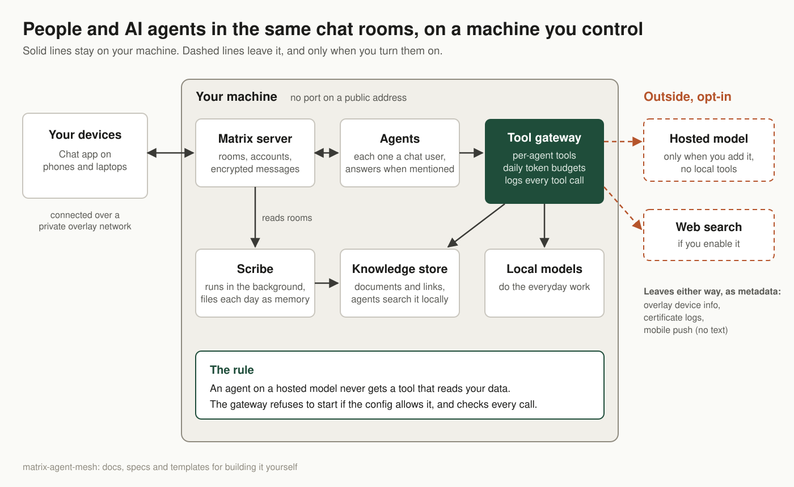

# matrix-agent-mesh

A private chat workspace where people and AI agents work in the same rooms, on hardware you control.



The goal is full privacy and data independence for a team that works with AI agents. Your messages, documents and the agents' memory stay on a machine you control, reachable only over your own private network. Local models do the everyday work. A hosted model joins only when you add it, and it is never given tools that read your own data. Nothing in the setup depends on a company keeping its servers, prices or terms.

## What "private" means here

**No port on a public address.** The services in this repo publish ports only on loopback or on the overlay address. The overlay network client keeps one UDP port open for its own encrypted connections between your devices. The only public piece is a static host that serves two small JSON files. The chat server, the agents and every tool they use are reached over the private overlay network, and phones and laptops join that network to use the workspace.

**Data stays on hardware you control.** Messages, documents, links and embeddings are stored on your own machine. Content leaves only through opt-in paths:

- Prompts you send to a hosted model.
- Search queries, if you enable a web search tool.
- Requests to the sites people link to in chat, if you turn on link metadata fetching in the scribe (`links.fetch_metadata`, off by default). Each request shows the linked site your host's public address and the time the link was saved.

The hosted-model rule below limits what a hosted model can reach.

Some metadata leaves the machine whether you opt in or not:

- The overlay network's coordination service sees device metadata, such as device names, addresses and when each device is online.
- Certificate transparency logs are public. The HTTPS certificates for the homeserver name the overlay host and the overlay network.
- Mobile push goes through the client vendor's push gateway to Apple or Google. The homeserver sends notification metadata that way. The template keeps message text out of push notifications.

**Hosted models are opt-in and kept away from local tools.** A cloud agent must never be able to call a tool that touches local data. A tool gateway built to the spec in this repo refuses to boot if its config breaks that rule, and at call time it checks each tool call against the agent's own tool list again. You will trigger the boot refusal yourself in chapter 04. Each agent also has a daily token budget, and each tool source can have an optional quota, such as a monthly search quota.

**Every agent tool call is logged.** The gateway writes one log line per call, so you can read back what each agent did and with which tool.

## The layers

Each chapter leaves a working system.

| Chapter | What you add | What works afterward |
|---|---|---|
| 00 Prerequisites | Docker, a local model runtime, a domain, a static host | Your machine can run everything that follows |
| 01 Private network | Overlay network, HTTPS names, binding rules | The host is reachable from your devices and from nowhere else |
| 02 Homeserver | Matrix homeserver, database, delegation | Humans chat with end-to-end encryption from phone and laptop |
| 02b Calls (optional) | Call media server and call auth | Voice and video calls between devices |
| 03 First persona | A bot bridge and a local model | `@local-agent` answers when mentioned in a room |
| 04 Tool gateway | Your build of the gateway spec | Agents use tools under per-agent permissions, budgets and a data boundary |
| 05 Scribe | Your build of the scribe spec | Each day's conversation becomes searchable memory |
| 06 Knowledge store | Knowledge store, vector index, knowledge MCP server | The scribe writes documents to the store, and you can search them by meaning |

## Where to stop

After chapter 02 you have private chat for people. After chapter 03 an agent sits in the room with you, and chapters 04 to 06 add control over what agents can do and memory of what was said.

## Placeholders

Templates hold `__NAME__` tokens, and `./render.sh` fills each one from the `.env` variable of the same name. Every token has a variable in `.env.example`, grouped by chapter. The tokens below describe your setup.

| Token | Meaning | Example value |
|---|---|---|
| `__SERVER_NAME__` | Matrix server name, the part after `:` in user IDs | `example.com` |
| `__HS_HOST__` | Delegated host on the overlay network | `mesh-host.example.net` |
| `__OVERLAY_IP__` | The host's address on the overlay network | `192.0.2.10` |
| `__MODEL_RUNTIME_URL__` | The model runtime's OpenAI-compatible address as containers reach it | `http://host.docker.internal:11434/v1` |

The other tokens are per-chapter values: `__LOCAL_MODEL__`, `__CLOUD_MODEL__`, `__LOCAL_AGENT_BASE_URL__` and `__SCRIBE_TIMEZONE__`, plus secrets. The secrets are `__POSTGRES_PASSWORD__`, `__REGISTRATION_SHARED_SECRET__`, `__MACAROON_SECRET_KEY__` and `__FORM_SECRET__` (chapter 02), `__LIVEKIT_KEY__` and `__LIVEKIT_SECRET__` (02b), the four `__LOCAL_AGENT_*__` tokens (03), and `__HOSTED_PROVIDER_API_KEY__` and `__SEARCH_API_KEY__` (04). So the templates never hold a secret, and the files in `rendered/` do. Git ignores `rendered/` and `.env`.

`WELLKNOWN_HOST` in `.env` is not a template token. The chapters use it in commands, written as `<WELLKNOWN_HOST>`, for the static host that serves the two `.well-known` files.

## How to use this repo

Copy the example environment file.

```bash
cp .env.example .env
chmod 600 .env
```

`.env` holds every secret, including the hosted provider and search keys, so keep it readable by you alone. The rendered files hold secrets too, so `./render.sh` sets `rendered/` to mode 700. Compose reads it to fill in the compose files, and only the gateway container receives the provider and search keys in its environment.

Fill in `.env` with your own values, then render the templates.

```bash
./render.sh
```

Open `compose.yaml` and uncomment the two include lines (`- path:` and `env_file:`) for the chapter you are on. Then start it.

```bash
docker compose up -d
```

## What this repo is not

It contains no code for the custom components. The tool gateway and the scribe are described as specs in `specs/`, and you build or choose your own. It does not cover host hardening or backups. Chapter 02 was smoke-tested on macOS for the homeserver and database; nothing else was tested on a clean machine. `VERSIONS.md` says what was tested where and what the reference deployment ran.

## License

The docs are licensed CC BY 4.0. The templates and scripts are licensed MIT. Code and config snippets inside the docs are also available under MIT.
